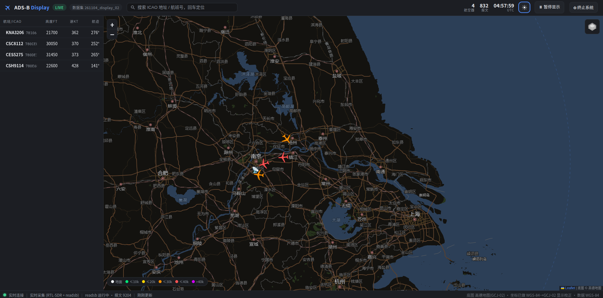
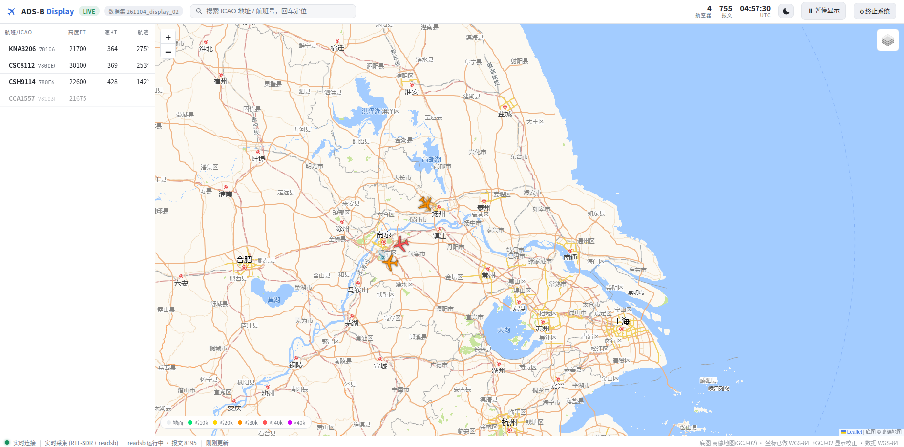
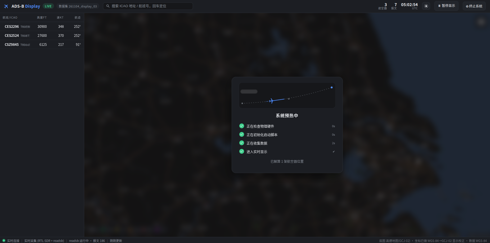

# ADS-B 实时地图显示

基于开放地图瓦片（高德）与 RTL-SDR 硬件的 ADS-B 报文实时解码地图显示系统。
接收 1090MHz ADS-B 信号，由 readsb 解码，后端聚合为航空器状态与轨迹，前端以
[globe.adsbexchange.com](https://globe.adsbexchange.com) 风格的暗色界面实时呈现。
无硬件时可用已采集的数据集回放，完整体验同样的界面与交互。

```
RTL-SDR Blog V4 ──1090MHz──> readsb（解码：每秒 aircraft.json + beast 原始报文）
                                   │
                                   ▼
                  backend/adsb_display（Python venv · 纯标准库）
                  ├── 采集器：轮询快照 → 状态库（最新状态 + 轨迹）→ tracks jsonl 落盘
                  └── HTTP 服务：静态前端 + REST API + SSE（1Hz 推送）
                                   │
                                   ▼
        前端 Leaflet 暗色地图：实时飞机图标 / 航班列表 / ICAO 轨迹与位置查询
```

**目录**

- [界面预览](#界面预览)
- [快速开始](#快速开始)
- [系统启动与控制](#系统启动与控制)
- [界面功能](#界面功能)
- [数据集](#数据集)
- [HTTP API](#http-api)
- [技术说明](#技术说明)
- [目录结构](#目录结构)
- [常见问题](#常见问题)
- [更新说明](#更新说明)

---

## 界面预览

**实时显示**：地图显示 + 实时飞机图标 + 选中航班的信息面板与航迹线



支持更改为亮色模式



**系统预热中**：live 启动后、收到真实数据前，全屏遮罩展示各阶段真实进度与耗时：



## 快速开始

```bash
cd "ADS-B Map display"
./run_display.sh                        # 自动检测：有 RTL-SDR → 实时采集；无 → 回放最新数据集
./run_display.sh live                   # 强制实时采集模式
./run_display.sh live 300               # 实时采集 300 秒后自动停止
./run_display.sh replay                 # 回放 data/ 下最新数据集
./run_display.sh replay 261028_test_reference   # 回放指定数据集
```

浏览器访问 <http://127.0.0.1:8080>（脚本通常会自动打开）。采集的数据自动保存到
`data/<日期>_display_<序号>/`，随时 Ctrl-C 或用界面上的「⏻ 终止系统」退出。

可选环境变量：`PORT`（端口，默认 8080）、`ADS_LAT / ADS_LON`（接收机坐标）、
`ADS_GAIN`（增益）、`NO_OPEN=1`（不自动打开浏览器）。

## 系统启动与控制

### 预热流程

live 模式启动后，前端在收到真实数据前显示全屏毛玻璃遮罩「系统预热中」，四个阶段的
进度与耗时均为**后端真实动作**（非定时模拟），通过 SSE 实时下发：

| 阶段                 | 实际发生的事                       | 就绪判据                     |
| -------------------- | ---------------------------------- | ---------------------------- |
| ① 正在检查物理硬件   | `lsusb` 检测 RTL-SDR（不独占设备） | 检测到 `0bda:2838/2832`      |
| ② 正在初始化启动脚本 | 创建数据集 → 拉起 readsb 子进程    | readsb 存活并开始输出        |
| ③ 正在收集数据       | 显示实时报文计数                   | **首个带位置航空器解算完成** |
| ④ 进入实时显示       | 遮罩淡出，进入正常界面             | —                            |

- 室内弱信号时 ③ 可能持续较久（属正常现象），**超过 20 秒出现「跳过」按钮**，
  点击直接进入显示；出错时显示原因并提供「仍要进入显示」。
- 回放模式无预热流程，启动即进入显示。

### 暂停显示

顶栏「⏸ 暂停显示」：后端**继续采集落盘**，仅停止向前端映射（SSE 转为心跳保活）。
点击后按钮变为「▶ 恢复显示」，再次点击画面无缝续上——包括暂停期间积累的轨迹。
适合"只存数据、暂不观看"的场景。

### 终止系统

顶栏「⏻ 终止系统」→ 确认弹窗 → 后端优雅退出（HTTP 服务 + 采集器 + readsb 全部停止），
前端显示「系统已终止」收尾页。已采集的数据在停止前均已落盘保存，无数据丢失。
也可通过命令行停止：前台 `Ctrl-C`；后台启动时 `pkill -f "adsb_display serve"`。

## 界面功能

| 功能           | 说明                                                                                                    |
| -------------- | ------------------------------------------------------------------------------------------------------- |
| 暗色地图       | 高德街道底图 CSS 反色为暗色风格；可切换卫星影像 + 路网注记图层                                          |
| 实时飞机图标   | 按航向旋转、按高度着色（左下角图例）；缩放 ≥9 级显示航班号标签                                          |
| 航班列表       | 左侧栏，按距离接收机的远近排序：航班号/ICAO、高度、速度、航迹                                           |
| 搜索           | 顶栏输入 ICAO hex 或航班号即时过滤列表，回车选中首个匹配                                                |
| 轨迹与位置查询 | 点击列表项或地图飞机 → 右侧信息面板（高度/速度/升降率/位置/距离方位/RSSI/报文数等）+ 地图绘制完整航迹线 |
| 跟随与定位     | 信息面板内「跟随追踪」持续居中该机，「定位到中心」放大查看                                              |
| 短尾迹         | 所有飞机自动绘制最近 ~25 秒的运动尾迹                                                                   |
| 回放控制       | 回放模式下可暂停/继续、拖动进度条、0.5×–10× 变速                                                        |
| 时钟切换       | 顶栏时钟默认显示 UTC，点击「UTC/北京时间」标签在两种时区间切换                                          |

## 数据集

每次实时采集自动在 `data/` 下创建数据集，命名规则 `<YYMMDD>_display_<NN>`
（如 `261103_display_01`，同日多次采集时 NN 自动递增），目录结构与既有采集项目
（261028_test）保持一致：

```
data/261103_display_01/
├── meta.json                  # 元数据（接收机坐标、增益、起止时间）
├── live/                      # readsb 原始输出：aircraft.json、history_*.json、stats…
├── logs/
│   ├── tracks-<TS>.jsonl      # 每秒一批、带位置航空器快照（与参考采集格式一致）
│   └── readsb-<TS>.log        # readsb 进程日志
└── beast/                     # readsb 原始报文（zstd 压缩，按小时轮转）
```

`data/261028_test_reference/` 为参考数据集 261028_test 的副本，用于无硬件回放演示。
回放以 1Hz 节奏重放并在前端实时播放，兼容两种 tracks jsonl 格式（平铺与批次化）。

## HTTP API

| 端点                                  | 说明                                                      |
| ------------------------------------- | --------------------------------------------------------- |
| `GET /`                               | 前端页面（frontend/ 静态托管）                            |
| `GET /api/state`                      | 全量状态快照（状态库 + 运行状态 + 预热进度）              |
| `GET /api/stream`                     | SSE 实时流，每秒推送一次快照；暂停期间仅发心跳            |
| `GET /api/track?hex=<ICAO>`           | 指定 ICAO 的完整轨迹点（`[t, lat, lon, alt, gs, track]`） |
| `GET /api/datasets`                   | 列出 data/ 下可回放数据集                                 |
| `GET /api/meta`                       | 服务元信息（接收机位置、模式、预热状态等）                |
| `POST /api/display/pause` \| `resume` | 暂停/恢复前端映射（采集不受影响）                         |
| `POST /api/warmup/skip`               | 跳过预热阶段，直接进入显示                                |
| `POST /api/system/shutdown`           | 优雅终止前后端（数据已保存）                              |
| `POST /api/replay/pause` \| `resume`  | 回放暂停/继续                                             |
| `POST /api/replay/speed?value=2`      | 回放倍速（0.1–60×）                                       |
| `POST /api/replay/seek?index=120`     | 回放跳转到第 N 批                                         |

## 技术说明

- **解码链路**：RTL-SDR → `readsb`（系统安装 3.16）完成信号解调与 Mode-S/ADS-B 报文
  解码（CPR 位置、速度、航向等）；后端每秒读取 `aircraft.json`，归一化为显示状态、
  维护每机轨迹、落盘数据集，并经 SSE 推送前端
- **报文计数口径**：顶栏「报文」仅统计**后端实际采集的 DF=17（ADS-B ES）且 CRC 校验
  通过**的报文——后端直连 readsb raw 输出端口（30002）逐帧解析，独立复算 Mode-S
  CRC-24 后计数（`msgstats.py`），与 `aircraft.json` 的全类型 `messages` 总数不同
- **零 pip 依赖**：后端为 Python 纯标准库实现（ThreadingHTTPServer + SSE）；venv 通过
  `python3 -m venv --without-pip` 创建（本机 ensurepip 缺失，也避免任何全局安装）
- **坐标系统**：底图为高德 GCJ-02，前端显示层做 WGS-84 → GCJ-02 校正（`js/gcj02.js`）；
  所有数据存储与 API 均保持 WGS-84
- **地图瓦片**：Leaflet 1.9.4 已本地化（`frontend/vendor/`）；瓦片渲染时经公网实时
  请求高德服务器，中国大陆网络可直接访问（本网络实测 OSM/Esri 等不可达，故选高德）。
  所用瓦片地址为高德实际开放但未正式文档化的接口，适合研究演示用途
- **接收机参数**：默认坐标 31.939590, 118.785800（与参考采集一致）、增益 40.2、
  最大范围 500km；可用 `ADS_LAT / ADS_LON / ADS_GAIN` 覆盖

## 目录结构

```
ADS-B Map display/
├── run_display.sh              # 一键启动（采集/回放自动选择）
├── backend/adsb_display/       # Python 包
│   ├── warmup.py               #   预热状态机（真实阶段判据）
│   ├── collector.py            #   readsb 子进程管理 + 快照轮询 + 落盘
│   ├── msgstats.py             #   DF17 报文统计（raw 端口 + CRC 校验）
│   ├── replay.py               #   数据集回放源（1Hz，可调速）
│   ├── state.py                #   航空器状态库（最新状态 + 轨迹 + 老化）
│   ├── dataset.py              #   数据集命名/创建/扫描
│   ├── server.py               #   HTTP 服务（静态 + REST + SSE + 控制端点）
│   └── __main__.py             #   CLI 入口与预热编排
├── frontend/                   # index.html + css/ + js/（含 gcj02 校正）+ vendor/leaflet
├── data/                       # 数据集（自动命名）与回放源
├── logs/                       # 服务运行日志
└── .venv/                      # 项目虚拟环境（无 pip）
```

## 常见问题

- **提示无设备 / 收不到飞机**：确认 `lsusb` 能看到 `0bda:2838`，且没有其他程序占用
  RTL-SDR（如系统 readsb 服务）。室内无 LNA 天线信号弱属正常，参考项目日志已有记录；
  预热阶段可用「跳过」先进入显示。
- **地图空白**：地图瓦片在页面渲染时通过公网向高德服务器实时请求（中国大陆网络通
  常可直接访问，本项目正是实测 OSM/Esri 不可达后选用高德）。若所在网络屏蔽了
  `*.is.autonavi.com` 或完全离线，底图会空白，但列表/信息面板等界面功能不受影响。
- **没有可回放数据集**：`data/` 为空时回放模式无法启动，请先运行一次 live 采集。
- **浏览器提示连接断开**：服务可能已被「终止系统」停止，重新运行 `./run_display.sh` 即可。

## 更新说明

### v1.2（2026-11-04）— 显示逻辑修正 优化前端

- **暂停显示修复**：修复暂停后按钮不切换、无法恢复的问题（暂停心跳此前未同步
  前端暂停状态，导致再次点击仍发送暂停指令）；移除暂停横幅，改为顶栏按钮
  图标切换（⏸ 暂停显示 ↔ ▶ 恢复显示），后台采集不受影响
- **报文计数口径**：顶栏「报文」改为仅统计后端实际采集的 **DF=17 且 CRC 校验通过**
  的报文（新增 `msgstats.py`：直连 readsb raw 端口逐帧解析并独立复算 Mode-S
  CRC-24），不再使用 aircraft.json 的全类型报文总数
- **时钟切换**：顶栏时钟点击可在 UTC 与北京时间之间切换
- **显示风格切换**：支持在暗色和亮色模式之间切换，初始化、显示界面、按钮弹窗风格同步变化
- **新增动画：**新增系统初始化界面的简约加载动画

### v1.1（2026-11-03）— 系统控制能力

在前端实时显示的基础上，补齐了系统级的启动反馈与控制能力：

- **预热遮罩**：live 启动时前端显示「系统预热中」，四阶段进度（检查硬件 → 初始化 →
  收集数据 → 实时显示）全部由后端真实动作驱动并经 SSE 实时下发，非定时模拟；
  收集阶段超过 20 秒出现「跳过」按钮，出错时显示原因并可强制进入显示
- **暂停显示**：新增 `POST /api/display/pause|resume`。后端采集落盘持续进行，
  仅停止向前端映射（SSE 转心跳保活），恢复后画面无缝续上
- **终止系统**：新增 `POST /api/system/shutdown` 与前端确认弹窗，一键优雅退出
  HTTP 服务 + 采集器 + readsb，数据保全、进程零残留；前端显示收尾页
- 新增 `warmup.py` 预热状态机模块；README 重构并加入界面截图
- 已在真实 RTL-SDR 硬件上完成全部功能的端到端验证（预热真实耗时呈现、
  暂停期间 tracks jsonl 持续增长、终止后进程干净退出）

### v1.0（2026-10-28/29）— 初始版本

- RTL-SDR + readsb 实时采集链路，数据集自动命名（`<YYMMDD>_display_<NN>`）
  并按参考项目目录规则落盘（meta / live / logs / beast）
- 仿 globe.adsbexchange.com 暗色前端：实时飞机图标（航向旋转、高度着色）、
  航班列表、搜索、ICAO 选择轨迹与位置查询、信息面板、跟随追踪
- 数据集回放模式（1Hz，可暂停/变速/跳转，兼容平铺与批次化 tracks 格式），
  无硬件亦可演示；高德瓦片 + GCJ-02 显示校正，Leaflet 本地化
- 一键启动脚本 `run_display.sh`（硬件检测自动选择模式）；纯标准库后端，
  venv 隔离，零 pip 依赖
