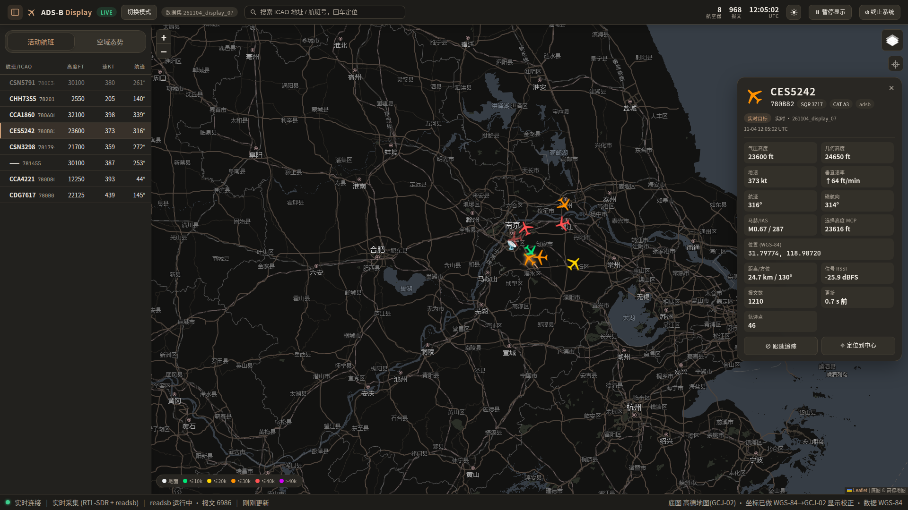
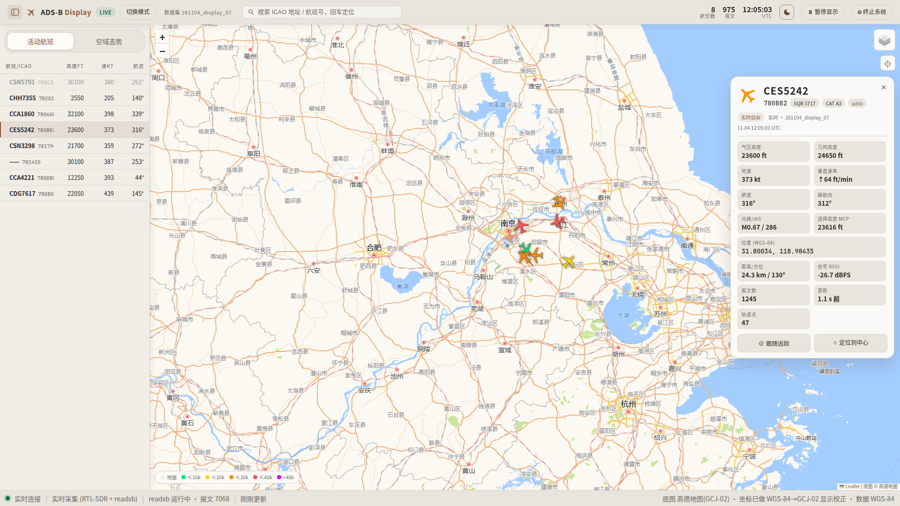
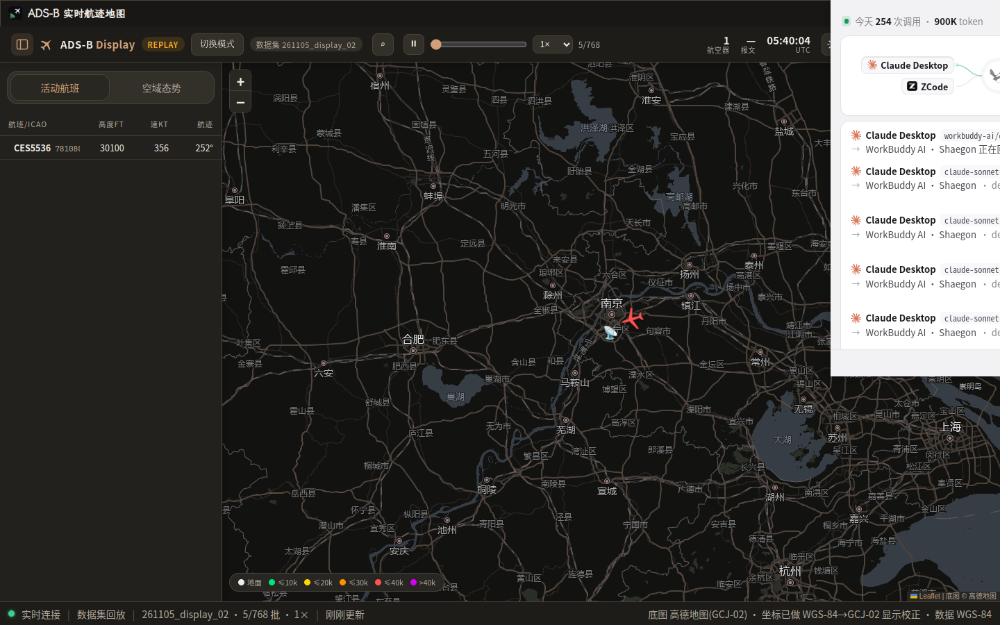
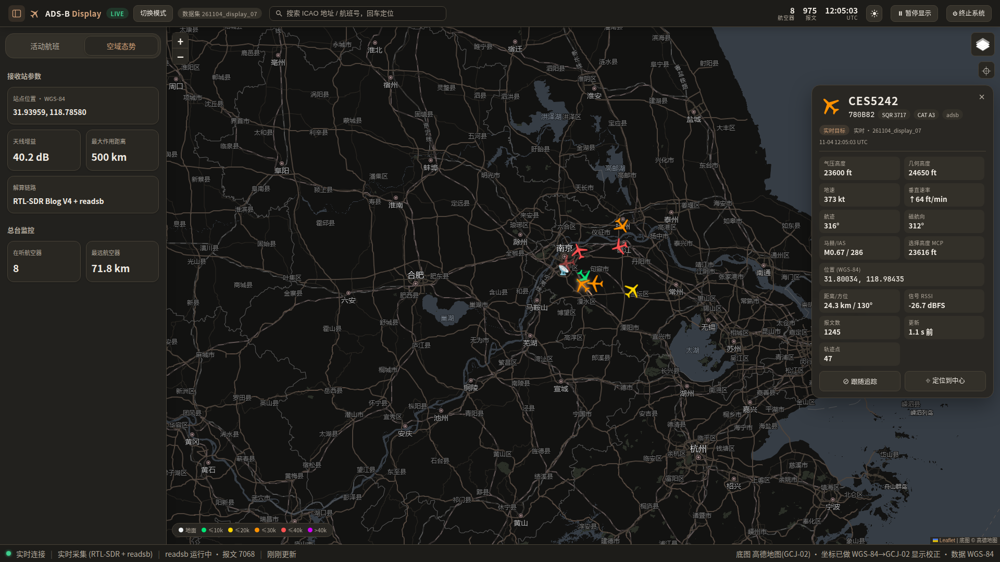
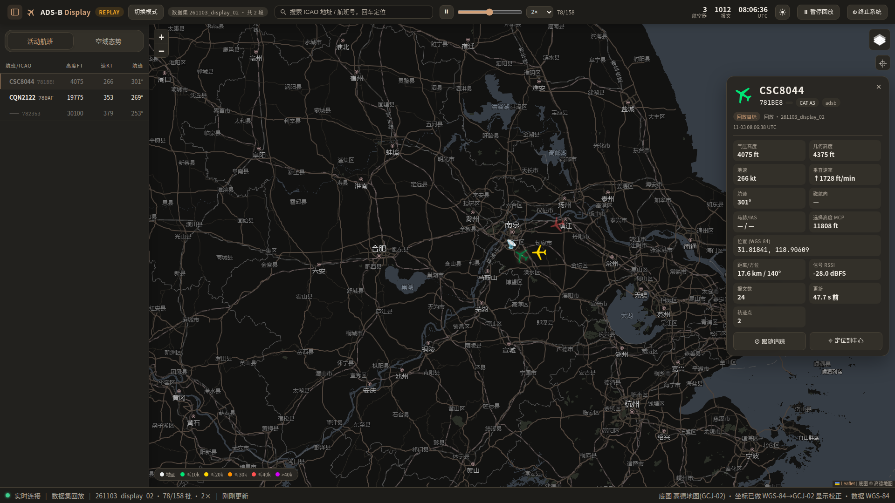
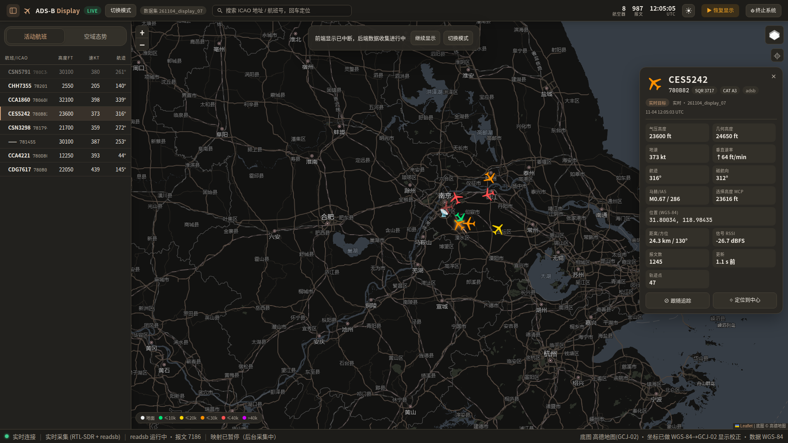
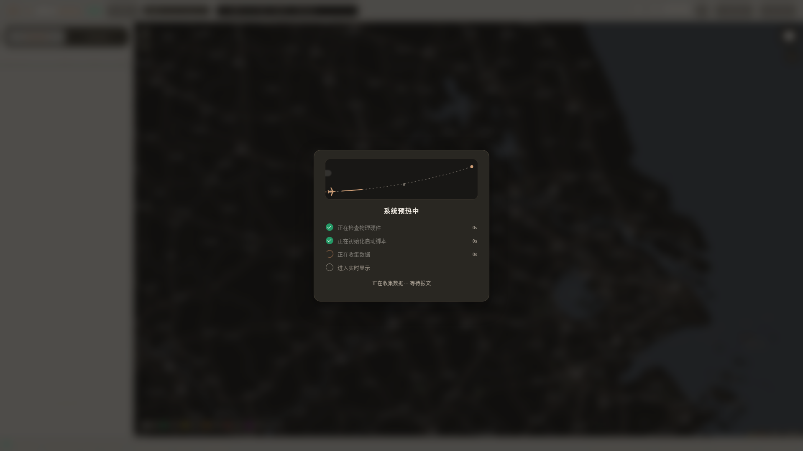

# ADS-B 实时地图显示

基于开放地图瓦片（高德）与 RTL-SDR 硬件的 ADS-B 报文实时解码地图显示系统。
接收 1090MHz ADS-B 信号，由 readsb 解码，后端聚合为航空器状态与轨迹，前端以
[globe.adsbexchange.com](https://globe.adsbexchange.com) 风格的地图界面实时呈现，支持暖灰明亮主题与暖石墨深色主题。
无硬件时可用已采集的数据集回放，完整体验同样的界面与交互。

```
RTL-SDR Blog V4 ──1090MHz──> readsb（解码：每秒 aircraft.json + beast 原始报文）
                                   │
                                   ▼
                  backend/adsb_display（Python venv · 纯标准库）
                  ├── 采集器：轮询快照 → 状态库（最新状态 + 轨迹）→ tracks jsonl 落盘
                  └── HTTP 服务：静态前端 + REST API + SSE（1Hz 推送）
                                   │
                                   ▼
        前端 Leaflet 地图（深浅主题）：实时飞机图标 / 航班列表 / ICAO 轨迹与位置查询
```

**目录**

- [界面预览](#界面预览)
- [快速开始](#快速开始)
- [系统启动与控制](#系统启动与控制)
- [界面功能](#界面功能)
- [数据集](#数据集)
- [HTTP API](#http-api)
- [技术说明](#技术说明)
- [目录结构](#目录结构)
- [常见问题](#常见问题)
- [开发验证](#开发验证)
- [更新说明](#更新说明)

---

## 界面预览

**实时显示**：地图显示 + 实时飞机图标 + 选中航班的信息面板与航迹线



明亮模式使用暖灰导航栏与轻阴影，与地图清晰区分；深色模式使用暖石墨与低饱和铜色点缀。



**原生独立桌面端**：免受浏览器干扰的原生独立窗口，自绘标题栏与网页双向主题同步，六态托盘图标：



**空域态势**：左栏切换查看接收站参数、在听航空器数量与最远距离。



**历史回放**：支持多数据集、进度跳转和倍速播放，后台采集报文计数持续更新。



**暂停显示**：顶栏下方的短浮层提供继续显示与模式切换，地图布局不受影响。



**系统预热中**：live 启动后、收到真实数据前，全屏遮罩展示各阶段真实进度与耗时：



## 快速开始

系统提供**浏览器工作流**（默认，免额外 GUI 依赖）与**原生独立桌面端**（独立窗口与托盘）两种使用形态：

| 模式                     | 启动命令                   | 特点与运行依赖                                                                   |
| ------------------------ | -------------------------- | -------------------------------------------------------------------------------- |
| **浏览器工作流**（默认） | `./run_display.sh`         | 自动启停后台服务并在浏览器打开地图，Python 3.10+ 标准库零依赖                    |
| **原生独立桌面端**       | `./desktop/run_desktop.sh` | 独立窗口、自绘标题栏主题同步、六色托盘、待机引导；依赖 `desktop/.venv` (PySide6) |

### 1. 浏览器工作流快速启动

```bash
cd "ADS-B Map display"
./run_display.sh                        # 自动检测：有 RTL-SDR → 实时采集；无 → 回放最新数据集
./run_display.sh live                   # 强制实时采集模式
./run_display.sh live 300               # 实时采集 300 秒后自动停止
./run_display.sh replay                 # 回放 data/ 下最新数据集
./run_display.sh replay 261028_test_reference   # 回放指定数据集
```

浏览器访问 <http://127.0.0.1:8080>（脚本通常会自动打开）。采集的数据自动保存到
`data/<日期>_display_<序号>/`，随时 Ctrl-C 或用界面上的「⏻ 终止系统」退出。

可选环境变量：`PORT`（端口，默认 8080）、`ADS_LAT / ADS_LON`（接收机坐标）、
`ADS_GAIN`（增益）、`NO_OPEN=1`（不自动打开浏览器）。

### 2. 原生独立桌面端快速启动

基于 **PySide6 + Qt WebEngine** 提供面向 Ubuntu / GNOME 的独立桌面窗口（运行环境与主项目隔离，位于 `desktop/.venv`）：

- **窗口与主题联动**：自绘标题栏与网页双向主题同步（深色暖石墨 / 浅色暖灰），支持连续切换与偏好记忆。
- **六色系统托盘**：直观指示状态（黄:预热 / 绿:实时采集 / 橙:历史回放 / 蓝:无源待机 IDLE / 红:故障 / 灰:退出）。
- **待机与硬件再判定**：无硬件且无数据时自动进入蓝色待机页，支持重新检测 RTL-SDR 硬件及选择外部目录回放。
- **GNOME 快捷方式**：支持通过脚本一键注册到应用菜单与 Dock 常驻。

```bash
# 1. 首次初始化环境
./desktop/setup_env.sh

# 2. 启动桌面端（支持 --mode live|replay|auto、--dataset <路径>、--port <端口>）
./desktop/run_desktop.sh

# 3. （可选）安装 GNOME 桌面快捷方式
./desktop/install_menu.sh
```

> 详细命令行参数、架构设计与测试说明见 [desktop/README.md](desktop/README.md)。

## 系统启动与控制

### 预热流程

live 模式启动后，前端在收到真实数据前显示全屏毛玻璃遮罩「系统预热中」，四个阶段的
进度与耗时均为**后端真实动作**（非定时模拟），通过 SSE 实时下发：

| 阶段                 | 实际发生的事                       | 就绪判据                     |
| -------------------- | ---------------------------------- | ---------------------------- |
| ① 正在检查物理硬件   | `lsusb` 检测 RTL-SDR（不独占设备） | 检测到 `0bda:2838/2832`      |
| ② 正在初始化启动脚本 | 创建数据集 → 拉起 readsb 子进程    | readsb 存活并开始输出        |
| ③ 正在收集数据       | 显示实时报文计数                   | **首个带位置航空器解算完成** |
| ④ 进入实时显示       | 遮罩淡出，进入正常界面             | —                            |

- 室内弱信号时 ③ 可能持续较久（属正常现象），**超过 20 秒出现「跳过」按钮**，
  点击直接进入显示；出错时显示原因并提供「仍要进入显示」。
- 回放模式无预热流程，启动即进入显示。

### 暂停显示

顶栏「⏸ 暂停显示」：后端**继续采集落盘**，仅停止向前端映射（SSE 转为心跳保活）。
点击后在顶栏下方居中显示短浮层，可选择「继续显示」或「切换模式」。浮层不挤压地图、
不遮罩页面，也不抢占键盘焦点。恢复后画面无缝续上，包括暂停期间积累的轨迹。
适合"只存数据、暂不观看"的场景。

### 页面内切换回放

LIVE 未暂停时，点击顶栏「切换模式」会在视口中央提示「请先暂停显示」，停留 1 秒后
用 200ms 渐出；连续点击会重新计时，不会自动暂停或打开数据集窗口。
先点击「暂停显示」，再点击 LIVE 旁或暂停浮层中的「切换模式」即可选择数据集；也可以从
终止确认弹窗中的「切换模式」进入，取消弹窗不会改变原来的播放状态。

选择一个或多个历史数据集后点击「回放」。列表排除当前正在采集的数据集，按创建时间
排序播放；段内保留真实采样节奏，段间跳过空档并清空上一段状态。支持 tracks 日志及
旧版 history 回退。顶部 REPLAY、当前段名和总段数随播放更新，时钟显示回放数据时间。
接收站参数与距离统计使用当前段的元数据，缺失字段沿用启动配置。

回放只切换显示源，readsb、实时状态库、DF17 计数和采集落盘持续运行。回放期间仍可
搜索、查看轨迹、暂停、拖动进度及选择 0.5×–10× 倍速；顶部两个暂停入口均暂停回放。
再次点击「切换模式」可更换数据集或「返回实时」，立即恢复后台持续更新的实时画面。
通过命令行以 replay 模式启动时，只支持更换数据集，「返回实时」禁用，不会启动硬件。
命令行 `--no-loop` 在更换数据集后仍生效；默认循环回放。

### 侧栏、站点定位与 UI 缩放

- 左侧「活动航班 / 空域态势」切换航班列表和站点、增益、作用距离、航空器数量及
  最远距离统计。统计基于当前显示源完整活动集，不受搜索过滤影响；实时显示暂停时冻结。
- 点击顶栏 Logo 左侧的矩形分隔图标收起或展开侧栏，刷新后保持；右上角图层控件下的 ⌖ 返回接收站，
  保留地图缩放级别并取消航空器跟随。
- Ctrl+滚轮、Ctrl+= / Ctrl+- 调节 UI 为 100%–200%，Ctrl+0 复位。只缩放顶栏、侧栏和
  状态栏，地图使用自身的缩放控件。界面缩放级别在刷新后保持。
- 顶栏空间不足时，搜索框折叠为搜索按钮，点击可展开搜索；继续放大会导致控件溢出时
  自动限制缩放。100% 下仍不足则使用两行顶栏；窗口扩大后重新计算上限。
- 全屏弹窗以浏览器视口居中，不受 UI 缩放影响；选择数据集与终止确认支持 Esc 取消、
  Tab 焦点循环与关闭后焦点恢复。正在提交切换时需等待请求完成。

### 航空器详情卡

点击飞机或航班列表打开右侧详情卡。卡片位于图层与定位控件下方，图层菜单展开时自动
避让；地图拖动、缩放、底图切换、站点定位及侧栏切换均不会关闭卡片。窗口高度不足时，
参数区内部滚动，标题、关闭按钮与底部操作保持可见。

详情卡只有点击 X 才关闭，点击其他飞机时更新同一张卡片。飞机失联时保留最后详情并标注
「已失联」；模式切换、跨段、回放跳转或循环后，目标不在当前活动集时
标注「来源 / 时刻已变化」，保留原数据源与快照 UTC 时间。无活动目标时停止轨迹请求并禁用跟随，有最后
位置时仍可「定位到最后位置」；同一 ICAO 重新出现时自动恢复更新。刷新页面不会恢复选择。

### 终止系统

顶栏「⏻ 终止系统」→ 确认弹窗 → 后端优雅退出（HTTP 服务 + 采集器 + readsb 全部停止），
前端显示「系统已终止」收尾页。已采集的数据在停止前均已落盘保存，无数据丢失。
也可通过命令行停止：前台 `Ctrl-C`；后台启动时 `pkill -f "adsb_display serve"`。

## 界面功能

| 功能           | 说明                                                                                                    |
| -------------- | ------------------------------------------------------------------------------------------------------- |
| 双主题地图     | 暖灰明亮 / 暖石墨深色主题，深色街道降低饱和度；可切换原色卫星影像 + 路网注记图层                        |
| 实时飞机图标   | 按航向旋转、按高度着色（左下角图例）；缩放 ≥9 级显示航班号标签                                          |
| 航班列表       | 左侧栏，按距离接收机的远近排序：航班号/ICAO、高度、速度、航迹                                           |
| 搜索           | 顶栏输入 ICAO hex 或航班号即时过滤列表，回车选中首个匹配                                                |
| 轨迹与位置查询 | 点击列表项或地图飞机 → 右侧信息面板（高度/速度/升降率/位置/距离方位/RSSI/报文数等）+ 地图绘制完整航迹线 |
| 跟随与定位     | 信息面板内「跟随追踪」持续居中该机，「定位到中心」放大查看                                              |
| 短尾迹         | 所有飞机自动绘制最近 ~25 秒的运动尾迹                                                                   |
| 回放控制       | 页面内切换、多选历史数据集、返回实时；暂停/继续、拖动进度条、0.5×–10× 变速                              |
| 时钟切换       | 顶栏时钟默认显示 UTC，点击「UTC/北京时间」标签在两种时区间切换                                          |

## 数据集

每次实时采集自动在 `data/` 下创建数据集，命名规则 `<YYMMDD>_display_<NN>`
（如 `261103_display_01`，同日多次采集时 NN 自动递增），目录结构与既有采集项目
（261028_test）保持一致：

```
data/261103_display_01/
├── meta.json                  # 元数据（接收机坐标、增益、起止时间）
├── live/                      # readsb 原始输出：aircraft.json、history_*.json、stats…
├── logs/
│   ├── tracks-<TS>.jsonl      # 每秒一批、带位置航空器快照（与参考采集格式一致）
│   └── readsb-<TS>.log        # readsb 进程日志
└── beast/                     # readsb 原始报文（zstd 压缩，按小时轮转）
```

`data/261028_test_reference/` 为参考数据集 261028_test 的副本，用于无硬件回放演示。
回放以 1Hz 节奏重放并在前端实时播放，兼容两种 tracks jsonl 格式（平铺与批次化）。

## HTTP API

| 端点                                  | 说明                                                      |
| ------------------------------------- | --------------------------------------------------------- |
| `GET /`                               | 前端页面（frontend/ 静态托管）                            |
| `GET /api/state`                      | 全量状态快照（状态库 + 运行状态 + 预热进度）              |
| `GET /api/stream`                     | SSE 实时流，每秒推送一次快照；暂停期间仅发心跳            |
| `GET /api/track?hex=<ICAO>`           | 指定 ICAO 的完整轨迹点（`[t, lat, lon, alt, gs, track]`） |
| `GET /api/datasets`                   | 列出历史数据集，含 `created_local`、`collecting`          |
| `GET /api/meta`                       | 服务元信息（接收机位置、模式、预热状态等）                |
| `POST /api/display/pause` \| `resume` | 暂停/恢复前端映射（采集不受影响）                         |
| `POST /api/display/replay`            | JSON `{"datasets":["名称", "..."]}`，启动或更换回放显示   |
| `POST /api/display/live`              | 返回实时显示并解除显示冻结；未启动采集时返回 400          |
| `POST /api/warmup/skip`               | 跳过预热阶段，直接进入显示                                |
| `POST /api/system/shutdown`           | 优雅终止前后端（数据已保存）                              |
| `POST /api/replay/pause` \| `resume`  | 回放暂停/继续                                             |
| `POST /api/replay/speed?value=2`      | 回放倍速（0.1–60×）                                       |
| `POST /api/replay/seek?index=120`     | 回放跳转到第 N 批                                         |

状态接口 `/api/meta`、`/api/state` 和 SSE 的 `status` 统一包含：

- `display_mode`：当前显示源；兼容字段 `mode` 与之相同。
- `session_id`：本次服务实例的唯一标识；重启后改变，前端据此重置版本比较并拦截旧会话响应。
- `display_revision`：显示源版本，切换、seek、循环或跨段重置后递增；`/api/track` 响应也
  携带该版本与 `session_id`，前端同时校验会话、请求版本和响应版本，避免旧异步响应污染新轨迹。
- `live_available`、`collecting_source`、`msgstats`：是否具备返回实时能力、后台采集状态和
  实时 DF17 统计；与当前显示源 `source` 分开。
- `dataset`、`datasets`、`receiver`：当前数据集、所选回放序列及当前显示段的接收站参数。

显示暂停时 SSE 和轮询均返回心跳及完整状态，航空器画面不更新，采集指标继续更新。
回放控制接口仅在回放显示时可用；数据集请求为空、重复、无效或包含当前采集目录时
返回 400，读取失败保留原显示源。服务保持原有 SSE 连接，无需重启。

## 技术说明

- **解码链路**：RTL-SDR → `readsb`（系统安装 3.16）完成信号解调与 Mode-S/ADS-B 报文
  解码（CPR 位置、速度、航向等）；后端每秒读取 `aircraft.json`，归一化为显示状态、
  维护每机轨迹、落盘数据集，并经 SSE 推送前端
- **报文计数口径**：顶栏「报文」仅统计**后端实际采集的 DF=17（ADS-B ES）且 CRC 校验
  通过**的报文——后端直连 readsb raw 输出端口（30002）逐帧解析，独立复算 Mode-S
  CRC-24 后计数（`msgstats.py`），与 `aircraft.json` 的全类型 `messages` 总数不同
- **零 pip 依赖**：后端为 Python 纯标准库实现（ThreadingHTTPServer + SSE）；venv 通过
  `python3 -m venv --without-pip` 创建（本机 ensurepip 缺失，也避免任何全局安装）
- **坐标系统**：底图为高德 GCJ-02，前端显示层做 WGS-84 → GCJ-02 校正（`js/gcj02.js`）；
  所有数据存储与 API 均保持 WGS-84
- **地图瓦片**：Leaflet 1.9.4 已本地化（`frontend/vendor/`）；瓦片渲染时经公网实时
  请求高德服务器，中国大陆网络可直接访问（本网络实测 OSM/Esri 等不可达，故选高德）。
  所用瓦片地址为高德实际开放但未正式文档化的接口，适合研究演示用途
- **接收机参数**：默认坐标 31.939590, 118.785800（与参考采集一致）、增益 40.2、
  最大范围 500km；可用 `ADS_LAT / ADS_LON / ADS_GAIN` 覆盖

## 目录结构

```
ADS-B Map display/
├── run_display.sh              # 一键启动（采集/回放自动选择）
├── backend/adsb_display/       # Python 包
│   ├── warmup.py               #   预热状态机（真实阶段判据）
│   ├── collector.py            #   readsb 子进程管理 + 快照轮询 + 落盘
│   ├── msgstats.py             #   DF17 报文统计（raw 端口 + CRC 校验）
│   ├── replay.py               #   数据集回放源（1Hz，可调速）
│   ├── state.py                #   航空器状态库（最新状态 + 轨迹 + 老化）
│   ├── dataset.py              #   数据集命名/创建/扫描与外部目录校验
│   ├── server.py               #   HTTP 服务（静态 + REST + SSE + 控制端点）
│   └── __main__.py             #   CLI 入口与预热编排
├── frontend/                   # index.html + css/ + js/（含 gcj02 校正）+ vendor/leaflet
├── desktop/                    # 原生独立桌面端 (PySide6 + Qt WebEngine)
│   ├── run_desktop.sh          #   桌面端日常启动入口
│   ├── setup_env.sh            #   独立虚拟环境与依赖装配脚本
│   ├── install_menu.sh         #   GNOME 桌面菜单项安装脚本
│   ├── uninstall_menu.sh       #   GNOME 桌面菜单项卸载脚本
│   ├── resources/              #   应用矢量与多尺寸高清图标 (SVG/PNG)
│   ├── src/adsb_desktop/       #   桌面端核心源码 (窗口、托盘、进程管理、单实例)
│   └── tests/                  #   桌面端单元与集成测试套件 (61 项)
├── data/                       # 数据集（自动命名）与回放源
├── logs/                       # 服务运行日志
└── .venv/                      # 项目虚拟环境（无 pip）
```

## 常见问题

- **提示无设备 / 收不到飞机**：确认 `lsusb` 能看到 `0bda:2838`，且没有其他程序占用
  RTL-SDR（如系统 readsb 服务）。室内无 LNA 天线信号弱属正常，参考项目日志已有记录；
  预热阶段可用「跳过」先进入显示；桌面端无设备且无内置数据时会自动进入蓝色待机态。
- **地图空白**：地图瓦片在页面渲染时通过公网向高德服务器实时请求（中国大陆网络通
  常可直接访问，本项目正是实测 OSM/Esri 不可达后选用高德）。若所在网络屏蔽了
  `*.is.autonavi.com` 或完全离线，底图会空白，但列表/信息面板等界面功能不受影响。
- **没有可回放数据集**：`data/` 为空时，浏览器回放模式无法启动；桌面端会自动转入
  待机页面，并提供「选择外部数据集」入口，可直接选取任意外部航迹目录。
- **浏览器提示连接断开**：服务可能已被「终止系统」停止，重新运行 `./run_display.sh` 即可。

## 更新说明

### v1.4（2026-11-07）— 原生独立桌面端、全栈主题联动与生命周期深度加固

- **原生独立桌面端架构（PySide6 + Qt WebEngine）**：面向 Ubuntu / GNOME / Wayland 环境推出原生独立窗口客户端（`desktop/`），基于 `PySide6 (Qt 6.12)` 与 Chromium 内核 WebEngine 深度复用既有 Python 后端、Web 前端与 readsb 硬件链路；具备专属 `desktop/.venv` 虚拟环境与依赖锁定（`requirements.lock`），与主项目纯标准库环境完全隔离。
- **全链路深浅主题无缝同步（Web ↔ Qt ↔ 窗口框架）**：彻底重构 WebEngine DOM 监听注入时序，攻克跨进程通信时序竞态；点击网页已有 `#btn-theme` 按钮即可实现自绘标题栏（Logo、控制按钮）、外层窗口背景与边框、加载页、错误页、待机页及系统调色板在 `dark`（暖石墨 `#1B1C1E` / 铬黄）与 `light`（暖灰 `#F4F5F7`）之间的毫秒级双向平滑同步，支持无缝连续切换，并在 `desktop/runtime/` 中跨重启持久化记忆恢复。
- **六色系统托盘与明确待机态（IDLE）**：完善托盘状态指示语义（黄色启动 `#EAB308`、绿色实时采集 `#22C55E`、橙色历史回放 `#F97316`、蓝色待机未播放 `#3B82F6`、红色故障异常 `#EF4444`、灰色正在退出 `#9CA3AF`）；当无硬件在位且无内置数据集时，应用平滑转入蓝色待机态，并在窗口展示专属待机指引页面（包含重新检测启动、选择外部数据集、打开目录等入口），明确区分正常待机与真实系统故障。
- **硬件动态再判定与外部数据集无缝加载**：保留命令行指定的 `auto` 探测模式，桌面端每次重新检测时动态刷新 RTL-SDR 硬件状态，支持热插拔后一键上线；通过后端 `inspect_dataset_dir` 深度递归校验航迹数据（`logs/tracks-*.jsonl` 或 `live/history_*.json`），支持桌面文件选择器直接挂载任意外部路径数据集回放，杜绝与同名内置数据集冲突。
- **代次递增与看门狗超时生命周期加固**：
  - `/api/system/shutdown` 引入会话 ID 隔离校验，旧会话延迟关闭请求返回 HTTP 409 Conflict，杜绝端口复用时误杀新后端；
  - 后端管理器引入代次递增（`_current_generation`、`_shutdown_gen`）与目标 PGID 固定绑定，旧代次定时器超时自动作废，彻底消除旧强杀定时器误杀新后端的竞态；
  - 退出与重启看门狗机制升级：超时强杀兜底（SIGKILL）严格以主进程及所属进程组（含 readsb 等孤儿进程）彻底消亡作为前置判定条件，在清理未完成时保持等待重试，绝不提前终止 Qt 事件循环或在旧进程残留时拉起新实例。
- **单实例互斥与 GNOME 原生桌面集成**：基于 `QLockFile + QLocalServer` 实现用户级单实例互斥，重复启动自动向主实例发送唤起信号并前置窗口；提供幂等的 `install_menu.sh` 与 `uninstall_menu.sh` 脚本，自动安装带矢量/高清图标的 `.desktop` 菜单项，支持 GNOME 搜索与 Dock 常驻。
- **全方位测试覆盖与视觉验收**：新增 34 项针对桌面生命周期、会话隔离、主题联动、外部数据集与故障注入（模拟 SIGKILL 延迟生效）的全面测试，全量 93 项自动化测试（61 项桌面端 + 20 项后端 + 12 项回归）全部通过；提供自动化的 Wayland 会话端到端全态截图与视觉验收脚本。

### v1.3.2（2026-11-05）— 数据时序、重连与回放控制修复

- **旧快照与失联老化**：以 readsb 快照自带的 `now` 计算报文与位置时间，重复或倒序快照不再
  刷新飞机状态、追加航迹或重复落盘；保留真实空快照。快照停更、文件缺失/损坏及解码进程
  重启等待期间，独立按当前时间清理失联目标与过期轨迹，收到新快照后正常恢复。
- **服务重启恢复**：状态与轨迹接口新增 `session_id`；前端在新服务会话中重新接受从零开始的
  显示版本，无需刷新页面，同时拦截旧会话迟到的状态与轨迹响应，避免画面冻结或被旧数据覆盖。
- **回放进度条同步**：仅在鼠标拖动或导航按键按下期间暂停滑块同步；松开后继续跟随回放进度，
  保留键盘焦点，修复拖动后滑块长期停留在原位置的问题。
- **接收范围单位**：传给 `readsb --max-range` 前将公里换算为海里，界面、配置与元数据仍使用
  公里；默认 500 km 对应约 269.978 海里，修复实际解码范围与地图范围圈不一致的问题。
- **回归验证**：新增 8 项后端用例与 v1.3.2 专项 Chromium 脚本；共 32 项 Python 测试及三套
  浏览器测试通过，覆盖已有模式切换、持续落盘、统计、详情、双主题和多尺寸布局，以及上述修复场景。

### v1.3.1（2026-11-05）— 前端交互与视觉完善

- **顶栏与侧栏**：侧栏开关移至 Logo 左侧，使用圆角矩形加竖线的 SVG 图标，保留收起动画、
  刷新后状态恢复及地图尺寸同步；“活动航班 / 空域态势”改为圆角分段按钮，完善方向键、
  Home / End 键切换。
- **暂停提示**：原贯穿页面的横幅改为顶栏下方居中的短浮层，提供“继续显示 / 切换模式”，
  不挤压地图、不增加遮罩、不抢焦点；统一按钮行高，避免暂停图标变化导致顶栏和地图跳动。
- **切换前提醒**：LIVE 未暂停时，顶栏“切换模式”可点击，但仅在视口中央提示“请先暂停显示”，
  完整停留 1 秒后以 200ms 渐出；连续点击重新计时，渐出中点击立即恢复提示。暂停成功或打开
  其他弹窗时清除提示，减少动画模式下停留 1 秒后直接隐藏；已暂停和 REPLAY 模式继续正常选数据集。
- **详情卡常驻与避让**：卡片移至右上图层、定位控件下方，随菜单展开自动避让；空间不足时参数区
  内部滚动，标题、X 和底部操作保持可见。地图操作、侧栏切换、飞机失联、模式切换、跨段、seek
  或循环均不关闭卡片，只有 X 关闭；选择其他飞机立即更新同一张卡片。
- **详情数据与轨迹**：保留最后有效详情、原数据源及 UTC 快照时间，明确标注“已失联”或
  “来源 / 时刻已变化”。无活动目标时停止跟随与无效轨迹请求，保留最后位置定位；同一 ICAO
  再次出现时恢复更新。补充选择版本校验，拦截关闭后重选同一飞机的旧轨迹响应，刷新页面不恢复目标。
- **双主题与样式**：明亮模式使用暖灰导航栏、细分隔线与轻阴影；深色模式采用暖石墨与低饱和铜色，
  降低深色街道底图的饱和度，卫星图保持原色。统一按钮、搜索、统计卡、详情与系统弹窗样式，
  合并重复 CSS 规则，修正窄窗口下两种主题的侧栏宽度一致性。

### v1.3（2026-11-04）— 页面回放切换与空域态势

- 采集与显示隔离，支持多数据集回放、跨段跳转、返回实时及持续采集指标。
- 新增暂停提示、全屏数据集选择弹窗、空域态势、侧栏收起与站点定位。
- 状态栏增大字号，新增 UI 缩放、搜索折叠、顶栏两行布局与尺寸自适应。
- 增加显示源版本校验、无依赖后端回归及 Chromium 浏览器验收脚本。

### v1.2.2（2026-11-04）— 稳定性、回放引擎与状态时序深度加固

- **回放线程与 Seek 并发安全**：重构 `ReplaySource` 条件变量与跳转唤醒机制，引入 `_seek_version` 同步版本控制，修复播放节拍等待期间拖拽进度条被后续自增索引覆盖的问题
- **双向跳转状态精确重构**：统一向前跳转（Seek Forward）与向后跳转（Seek Backward）的状态恢复机制，无论跳转方向均完整重建目标时刻前最近 5400 点航迹与 75 秒活动航空器，彻底消除向前跳转丢失视野飞机、向后跳转轨迹截断至 76 点的缺陷
- **时间大步长快进下的幽灵飞机消除**：重构 `AircraftStore.prune()`，采用统一快照分别计算活动超时与航迹超时集合，并增加孤儿清理，彻底解决跨越 30 分钟以上时间跳跃时飞机永久残留且 age 显示为 0 的 Bug
- **采集格式升级与采样时序保真**：`LiveCollector` 每秒保存包含真实时间戳的结构化批次 `{"now": ..., "aircraft": [...]}` 并保留空秒批次；`ReplaySource` 支持按真实采样时间差步进回放
- **history 环形缓冲区时间序修正**：`scan_replay_datasets` 读取快照 JSON 内 `now` 绝对时间戳进行全局排序，解决 readsb 环形缓冲区覆盖后编号自然序导致回放时间倒退（如 history_96 → history_97 倒退 3570 秒）的问题
- **数据源陈旧度与位置去重校准**：严格区分采集轮询时间、报文接收时间（扣除 `seen`）与位置更新时间（扣除 `seen_pos`），前端 age 与变灰状态准确反映真实信号延迟，并基于实际位置更新时间戳过滤无位移重复航迹点
- **空 tracks 文件智能回退**：扫描数据集时验证 tracks 文件中是否包含可解析有效记录，当存在 0 字节或无有效航空器记录的 tracks 文件时自动回退读取有效 history 快照
- **启动异常资源清理保障**：将采集资源启动（`readsb`、`Df17Counter`）与 HTTP 服务绑定纳入统一 `try...finally`，当端口被占用等异常导致启动失败时确保所有硬件进程与报文套接字干净退出，不留孤儿进程
- **暂停显示全链路同步与恢复**：统一 HTTP 轮询降级与 SSE 推送在显示暂停分支的拦截逻辑，防止轮询模式下飞机仍被刷新；`/api/meta` 初始元信息同步 `display_paused` 状态，解决暂停期间刷新页面无法恢复显示的问题
- **航迹满容量更新与异步防竞争**：
  - 前端航迹比对引入末点时间戳校验（`lastTs`），解决单机航迹达到 5400 点满容量后因点数不变导致轨迹线停止更新的问题
  - 严格校验 `/api/track` 异步响应 hex 与当前选中目标的一致性，防止旧目标返回 0 点数据时误删新选中飞机的航迹
- **API 参数边界校验**：`/api/track?limit=...` 非整数或负数返回 400 Bad Request；`/api/replay/speed` 拒绝 `NaN` / `Infinity` 参数返回 400

### v1.2.1（2026-11-04）— 缺陷修复与状态健壮性增强

- **状态库内存泄漏修复**：修复 `AircraftStore.prune()` 中 75 秒清理提前剔除 `last_seen` 导致 30 分钟轨迹无法释放的内存泄漏问题
- **回放引擎完善**：支持整文件解析 `history_*.json` 结构，修复数组逗号引起的解析丢包；支持回放文件自然序排序；支持拖拽进度条向后跳转（Seek Backward）自动重构视野状态；过滤无有效航迹记录的空数据集
- **前端渲染性能与交互优化**：
  - 解耦飞机航向旋转与 Marker Icon 重新创建，避免每秒 DOM 强制销毁重建与抖动，保证选中高亮环持续有效
  - 修复飞机失联后航迹线残留和幽灵请求问题，修复切换至 0 航迹点目标时上一目标航迹线未清除的问题
  - 统一搜索框回车快速定位与侧栏过滤匹配规则（支持模糊子串匹配）
  - 回放模式下顶栏暂停按钮自动映射为回放暂停/恢复控制，消除控制语义冲突
  - 增强 SSE 断线自动降级 HTTP 轮询容错，预热遮罩淡出增加定时保底
- **硬件配置与代码优化**：
  - 统一 readsb Raw 端口配置（联动 `ADS_RAW_PORT`），子进程文件描述符安全关闭
  - `msgstats.py` 启用 Mode-S CRC 查表快速算法，提升高频报文解析吞吐量
  - 预热状态机推进时自动清空历史暂态错误；CLI 优化支持数据集路径带有末尾斜杠

### v1.2（2026-11-04）— 显示逻辑修正 优化前端

- **暂停显示修复**：修复暂停后按钮不切换、无法恢复的问题（暂停心跳此前未同步
  前端暂停状态，导致再次点击仍发送暂停指令）；移除暂停横幅，改为顶栏按钮
  图标切换（⏸ 暂停显示 ↔ ▶ 恢复显示），后台采集不受影响
- **报文计数口径**：顶栏「报文」改为仅统计后端实际采集的 **DF=17 且 CRC 校验通过**
  的报文（新增 `msgstats.py`：直连 readsb raw 端口逐帧解析并独立复算 Mode-S
  CRC-24），不再使用 aircraft.json 的全类型报文总数
- **时钟切换**：顶栏时钟点击可在 UTC 与北京时间之间切换
- **显示风格切换**：支持在暗色和亮色模式之间切换，初始化、显示界面、按钮弹窗风格同步变化
- **新增动画：**新增系统初始化界面的简约加载动画

### v1.1（2026-11-03）— 系统控制能力

在前端实时显示的基础上，补齐了系统级的启动反馈与控制能力：

- **预热遮罩**：live 启动时前端显示「系统预热中」，四阶段进度（检查硬件 → 初始化 →
  收集数据 → 实时显示）全部由后端真实动作驱动并经 SSE 实时下发，非定时模拟；
  收集阶段超过 20 秒出现「跳过」按钮，出错时显示原因并可强制进入显示
- **暂停显示**：新增 `POST /api/display/pause|resume`。后端采集落盘持续进行，
  仅停止向前端映射（SSE 转心跳保活），恢复后画面无缝续上
- **终止系统**：新增 `POST /api/system/shutdown` 与前端确认弹窗，一键优雅退出
  HTTP 服务 + 采集器 + readsb，数据保全、进程零残留；前端显示收尾页
- 新增 `warmup.py` 预热状态机模块；README 重构并加入界面截图
- 已在真实 RTL-SDR 硬件上完成全部功能的端到端验证（预热真实耗时呈现、
  暂停期间 tracks jsonl 持续增长、终止后进程干净退出）

### v1.0（2026-10-28/29）— 初始版本

- RTL-SDR + readsb 实时采集链路，数据集自动命名（`<YYMMDD>_display_<NN>`）
  并按参考项目目录规则落盘（meta / live / logs / beast）
- 仿 globe.adsbexchange.com 暗色前端：实时飞机图标（航向旋转、高度着色）、
  航班列表、搜索、ICAO 选择轨迹与位置查询、信息面板、跟随追踪
- 数据集回放模式（1Hz，可暂停/变速/跳转，兼容平铺与批次化 tracks 格式），
  无硬件亦可演示；高德瓦片 + GCJ-02 显示校正，Leaflet 本地化
- 一键启动脚本 `run_display.sh`（硬件检测自动选择模式）；纯标准库后端，
  venv 隔离，零 pip 依赖
